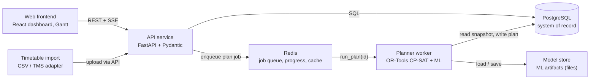

# Backend Specification

**AI-Powered Automatic Block Planning** · Smart India Hackathon 2026 · Problem Statement 26027

| | |
| --- | --- |
| Document | Backend design specification, version 1.0 (draft) |
| Date | 15 October 2026 |
| Status | Design. Only the planner core exists, as a prototype. |
| Tested | The code in Appendix A and B ran here (FastAPI, Pydantic v2, OR-Tools) |
| Syntax-checked | SQL (Appendix C) parses with the PostgreSQL parser; Compose (Appendix D) is valid YAML |
| Not yet run | Against a real database or Docker; no Celery code written yet |

> Prototype figures quoted here come from synthetic data and stated assumptions, not real railway data.
> This file has the same content as `SIH2026_PS26027_Backend_Specification.pdf`.

## Contents

- [1. Purpose and scope](#1-purpose-and-scope)
- [2. Design principles](#2-design-principles)
- [3. Architecture](#3-architecture)
- [4. Technology choices](#4-technology-choices)
- [5. Project structure](#5-project-structure)
- [6. Data model](#6-data-model)
- [7. API design](#7-api-design)
- [8. Workflows and state machines](#8-workflows-and-state-machines)
- [9. Validation rules](#9-validation-rules)
- [10. Planning service](#10-planning-service)
- [11. Traffic data and machine learning](#11-traffic-data-and-machine-learning)
- [12. Explanation service](#12-explanation-service)
- [13. Background jobs and progress](#13-background-jobs-and-progress)
- [14. Security](#14-security)
- [15. Observability and operations](#15-observability-and-operations)
- [16. Testing strategy](#16-testing-strategy)
- [17. Deployment](#17-deployment)
- [18. Performance and scalability](#18-performance-and-scalability)
- [19. Backend build plan](#19-backend-build-plan)
- [20. Risks, assumptions and open questions](#20-risks-assumptions-and-open-questions)
- [Appendix A. Request schema, role check and error format](#appendix-a-request-schema-role-check-and-error-format)
- [Appendix B. Planner extensions](#appendix-b-planner-extensions)
- [Appendix C. Core SQL](#appendix-c-core-sql)
- [Appendix D. Docker Compose (illustrative)](#appendix-d-docker-compose-illustrative)

## 1. Purpose and scope

This document specifies the backend of the integrated block planner. The backend is the system of record and the planning brain: it receives maintenance block requests from Engineering, Traction Distribution (TrD) and Signal and Telecom (S&T), stores the network, traffic and resource data, runs the planner as background jobs, keeps every schedule with its explanations, enforces roles and the approval workflow, and records what actually happened so the models can learn.

### What the backend is responsible for

- Accepting, validating and storing block requests, with dependencies between them.
- Holding reference data: sections, departments, crews, machines and their availability.
- Turning timetables into a traffic profile (how many trains run in each time slot of each section).
- Running the planner (OR-Tools CP-SAT) asynchronously and saving the resulting blocks and explanations.
- Comparing the integrated plan with an independent-planning baseline using the same metric function.
- Supporting review: what-if moves, overrides, approval and publication.
- Recording actual block outcomes and feeding them to the ML models.
- Authentication, role-based access and an append-only audit trail.

### What the backend is not

- It does not control trains, signals or power. It proposes a schedule; people approve it.
- It does not replace the Rolling Block Plan process. It automates and optimizes the planning step inside it.
- It does not need real railway data to be demonstrated. It starts on simulated data behind the same interfaces.

### Scope by phase

| Phase | Included |
| --- | --- |
| MVP | Login and roles; reference data; request CRUD and validation; traffic profile import; asynchronous plan runs with baseline comparison; schedule, conflicts and explanations; what-if and override; approve and publish; audit log. |
| Next | ML predictors (delay, block overrun) behind the cost interface; work dependencies; resource calendars; multi-section and power blocks. |
| Later | Adapters for the real Traffic Management System and Traction Distribution Management System; notifications; single sign-on; multi-division planning with rolling horizon. |

## 2. Design principles

1. **Human in the loop.** The system proposes; a planner approves or overrides. Nothing is published automatically.
2. **Explainable by construction.** Every block and placement carries reason codes and numbers computed from the data, not generated text.
3. **Validate before solving, check after solving.** Inputs are validated at the API. Every solver output is re-verified by an independent checker (as in the prototype) before it is saved.
4. **Reproducible records.** A plan run stores its input hash, weights, seed, model versions and the produced plan. The stored plan is the record; re-running is not relied on to reproduce it.
5. **Long work is asynchronous.** Solving is CPU-bound and can take a minute or more, so it runs in workers, never inside an API request.
6. **Swappable data sources.** Traffic and cost data sit behind interfaces, so simulated data, CSV uploads and real feeds are interchangeable.
7. **Safe by default.** Database constraints back up application rules (for example, published blocks cannot overlap on a section), and failures never leave a half-written plan.

## 3. Architecture



If your viewer does not render Mermaid, read the diagram like this: the web frontend talks to the API service; the API service reads and writes PostgreSQL and puts plan jobs into Redis; the planner worker takes jobs from Redis, reads a snapshot from PostgreSQL, loads ML models from the model store, and writes the finished plan back to PostgreSQL; timetable uploads go through the API.

*Figure 1. Backend components and main data flows.*

| Component | Responsibility |
| --- | --- |
| API service | Stateless FastAPI app. Authentication, validation, CRUD, state transitions, job creation, reads of plans and metrics, progress streaming. No solving. |
| Planner worker | Celery worker that runs the plan pipeline: snapshot, cost arrays, baseline, CP-SAT solve, checker, explanations, persistence. One solve per worker process. |
| PostgreSQL | System of record for all entities and plan history. Enforces integrity with constraints, including an exclusion constraint on published blocks. |
| Redis | Celery broker, cancellation flags, progress channel for server-sent events, short-lived caches. |
| Model store | Versioned ML artifacts (files) referenced from the ml_models table. |
| Timetable import | Script or adapter that loads timetables and rebuilds the traffic profile. |

### Life of a plan run

1. The client sends POST /plans. The API validates the body, stores a plan_runs row with status queued, and enqueues run_plan(plan_run_id). It answers 202 with a link to the run.
2. The worker marks the run running, loads a snapshot (requests, dependencies, sections, traffic, resources, model versions) and stores an input hash.
3. It builds integer cost arrays, computes the independent baseline plan and its metrics, then builds and solves the CP-SAT model within the time limit, publishing progress to Redis.
4. It runs the independent checker. Any violation fails the run instead of saving a bad plan.
5. In one database transaction it writes blocks, assignments, explanations and metrics, then marks the run succeeded.
6. The client follows progress through GET /plans/{id}/events or polling, then reviews the result.

## 4. Technology choices

| Concern | Choice | Why |
| --- | --- | --- |
| Language | Python 3.11 or newer | OR-Tools, scikit-learn and XGBoost are Python-first; one language end to end. |
| Web framework | FastAPI with Uvicorn (Gunicorn workers in production) | Typed request models, automatic OpenAPI docs, async support. |
| Validation | Pydantic v2 | Schemas double as API contract and documentation. |
| ORM and migrations | SQLAlchemy 2.0 and Alembic | Explicit transactions, versioned schema changes. |
| Database | PostgreSQL | Range types and exclusion constraints (btree_gist), JSONB, strong integrity. |
| Job queue | Celery with Redis | Mature, supports time limits, retries and revocation. Arq or RQ are lighter alternatives. |
| Optimization | OR-Tools CP-SAT | Handles interval, cumulative and element constraints; checkable results. |
| ML | scikit-learn and XGBoost, artifacts saved with joblib | Tabular data; strong results with modest data. |
| Auth | JWT access and refresh tokens, argon2id or bcrypt hashes | Stateless API; standard libraries. |
| Observability | JSON logs, Prometheus metrics, optional OpenTelemetry | Operate and debug a solver-backed service. |
| Testing | pytest, Hypothesis, httpx TestClient, a Postgres container, Locust or k6 | See section 16. |
| Packaging | Docker and Docker Compose; GitHub Actions for CI | One-command demo and repeatable builds. |

*Use current stable releases and pin exact versions in a lockfile. The snippets in the appendices were run with FastAPI 0.143, Pydantic 2.13 and OR-Tools 9.15.*

## 5. Project structure

```text
backend/
  app/
    main.py                  FastAPI app, routers, exception handlers
    config.py                settings from environment variables
    api/
      deps.py                database session, current user, role checks
      v1/  auth.py  reference.py  requests.py  traffic.py
           plans.py  blocks.py  ml.py  health.py
    core/  security.py  errors.py  logging.py  events.py
    db/
      base.py  session.py
      models/                SQLAlchemy models, one file per aggregate
    schemas/                 Pydantic request and response models
    services/                business rules, no HTTP and no solver code
      request_service.py  validation.py  plan_service.py
      explain.py  metrics.py  audit.py
    planner/                 pure Python, no database or HTTP imports
      slots.py               time <-> slot conversion
      snapshot.py            immutable input data for one run
      baseline.py            independent-planning plan
      model.py               CP-SAT model builder
      costs.py               CostProvider interface and implementations
      checker.py             independent constraint verifier
      metrics.py             closures, block hours, trains affected
    ml/  features.py  train.py  predict.py  registry.py
    workers/  celery_app.py  tasks.py
  migrations/                Alembic versions
  tests/  unit/  planner/  api/  db/  ml/  perf/
  scripts/  seed_synthetic.py  load_timetable.py
  docker/  Dockerfile.api  Dockerfile.worker
  pyproject.toml  .env.example
docker-compose.yml
```

The planner package is deliberately free of database and web imports. It takes a snapshot object and returns a plan object, which makes it testable on its own and keeps the prototype code easy to port.

## 6. Data model

Tables are grouped by purpose. Appendix C gives SQL for the core tables.

| Table | Purpose | Key columns |
| --- | --- | --- |
| departments, users | Who is acting and for which department | role (admin, planner, dept_user, viewer), department_id |
| sections, section_links | Network sections and their relations (adjacent, parallel, shared power feed) | code, division, line_count |
| block_requests | A department's request for a block | section_id, work_type, duration_minutes, earliest_date, deadline_date, priority, needs_power_block, status, version |
| request_dependencies | Ordering and sharing rules between requests | relation, min_gap_minutes |
| request_sections | Extra sections for multi-section requests (power blocks) | request_id, section_id |
| resources, resource_availability | Gangs, tower wagons, machines and their calendars | kind, department_id, start_ts, end_ts |
| timetable_entries | Trains per section from timetables | category, weight, days_of_week, enters_at, leaves_at |
| traffic_profile | Trains per slot per section per day, derived from timetables | section_id, day, slot_index, trains, weighted |
| plan_runs | One planner run with its settings and results | horizon, weights, seed, input_hash, model_versions, status, solver_status, metrics, parent_id |
| blocks | A closure of one section for a time window | section_id, start_ts, end_ts, status, trains_affected |
| plan_assignments | Where each request was placed in a run | request_id, block_id, start_ts, deferred, overridden |
| explanations | Reason codes and numbers for blocks and placements | code, text, numbers (JSONB) |
| block_actuals | What actually happened | granted, actual_start, actual_end, notes |
| ml_models | Registry of trained models | kind, version, metrics, artifact_path, is_active |
| audit_log | Append-only record of state-changing actions | user_id, action, entity, entity_id, details |

### Time and units

- Timestamps are stored as timestamptz in UTC and shown in Asia/Kolkata. Dates such as earliest_date are calendar dates in Asia/Kolkata.
- The solver works in integer slots counted from the horizon start. slot = floor((t - horizon_start) / slot_minutes). The default slot is 30 minutes, as in the prototype, and is configurable.
- Durations are rounded up to a whole number of slots when a request is normalized. The original minutes are kept.
- Requests use optimistic locking: updates must send the current version, otherwise the API answers 409.
- Indexes: block_requests (status, section_id), plan_assignments (plan_run_id), blocks (section_id, start_ts), traffic_profile primary key (section_id, day, slot_index).

> **Integrity at the database level.** A partial exclusion constraint on blocks (section_id with equality, tstzrange(start_ts, end_ts) with overlap, where status is published) makes it impossible for two published blocks to overlap on the same section, even if application code has a bug. It needs the btree_gist extension.

## 7. API design

### Conventions

- Base path /api/v1. JSON only. Timestamps in ISO 8601 with offset, for example 2026-10-19T00:00:00+05:30.
- Errors use the problem-details format (application/problem+json) with a stable machine-readable code and, for validation failures, a list of field errors.
- Lists use limit and cursor parameters and filters such as status, section and department.
- POST /plans accepts an Idempotency-Key header; repeating the same key returns the original run instead of creating another.
- Mutating requests carry the resource version; a mismatch returns 409 version_conflict.
- Status codes: 200 and 201 success, 202 accepted for async work, 400 malformed, 401 not signed in, 403 role not allowed, 404 not found, 409 conflict, 422 validation, 429 rate limited.

*Role letters: A = admin, P = planner, D = department user (own department), V = viewer.*

### Endpoints

| Method and path | Roles | Purpose |
| --- | --- | --- |
| `POST /auth/login` | public | Exchange email and password for access and refresh tokens |
| `POST /auth/refresh` | public | Rotate the refresh token and issue a new access token |
| `GET /me` | all | Current user, role and department |
| `GET /sections, /sections/{id}` | all | Sections and their relations |
| `GET /departments` | all | Departments |
| `GET /resources` | P, A | Gangs, tower wagons, machines |
| `PUT /resources/{id}/availability` | P, A | Replace availability windows |
| `POST /requests` | D, P, A | Create a draft request |
| `GET /requests` | all | List with filters (status, section, department, dates) |
| `GET /requests/{id}` | all | One request with dependencies |
| `PATCH /requests/{id}` | D (own), P, A | Update a draft or submitted request (needs version) |
| `POST /requests/{id}/submit` | D (own), P, A | Validate and submit for planning |
| `POST /requests/{id}/cancel` | D (own), P, A | Cancel a request |
| `PUT /requests/{id}/dependencies` | D (own), P, A | Replace dependencies (cycle-checked) |
| `POST /traffic/timetable` | P, A | Bulk upload timetable entries (CSV or JSON) |
| `POST /traffic/rebuild` | P, A | Rebuild the traffic profile for a date range |
| `GET /traffic/profile` | all | Trains per slot for a section and date range |
| `POST /plans` | P, A | Create a plan run. Returns 202 and a link |
| `GET /plans, /plans/{id}` | P, A, V | List runs; status, solver status, metrics |
| `GET /plans/{id}/schedule` | P, A, V | Blocks with their member requests |
| `GET /plans/{id}/baseline` | P, A, V | Independent-planning plan for comparison |
| `GET /plans/{id}/conflicts` | P, A, V | Conflicts found in the input and how they were resolved |
| `GET /plans/{id}/explanations` | P, A, V | Reason codes and numbers |
| `GET /plans/{id}/events` | P, A | Server-sent events: objective, bound, elapsed time |
| `POST /plans/{id}/cancel` | P, A | Stop a queued or running run |
| `POST /plans/{id}/whatif` | P, A | Try a move; returns the metric difference; nothing saved |
| `POST /plans/{id}/overrides` | P, A | Apply moves and re-solve; creates a child run |
| `POST /plans/{id}/approve` | P, A | Approve a succeeded run |
| `POST /plans/{id}/publish` | P, A | Publish blocks; supersedes the previous published run |
| `GET /blocks` | all | Published blocks as a calendar |
| `POST /blocks/{id}/actuals` | D (own), P, A | Record granted, actual start and end |
| `GET /ml/models, POST /ml/train` | P, A / A | List models; start training |
| `GET /health, /ready, /metrics` | public / internal | Liveness, readiness, Prometheus metrics |

### Example: create a request

```text
POST /api/v1/requests
{
  "section_code": "A-B",
  "work_type": "track",
  "duration_minutes": 180,
  "earliest_date": "2026-10-19",
  "deadline_date": "2026-10-23",
  "priority": 3,
  "needs_power_block": false
}

201 Created
{ "id": 101, "status": "draft", "department": "ENGG", "section_code": "A-B",
  "duration_minutes": 180, "version": 1 }
```

### Example: start a plan run

```text
POST /api/v1/plans            Idempotency-Key: 7f3c-plan-2026-10-19
{
  "horizon_start": "2026-10-19T00:00:00+05:30",
  "horizon_end":   "2026-10-26T00:00:00+05:30",
  "slot_minutes": 30,
  "weights": { "block": 150, "traffic": 10, "delay": 20, "defer": 1000 },
  "time_limit_s": 60
}

202 Accepted
{ "id": 12, "status": "queued", "links": { "self": "/api/v1/plans/12" } }
```

### Example: finished run and one block

*The metrics below are the synthetic prototype results; the block is taken from the prototype schedule.*

```text
GET /api/v1/plans/12
{ "id": 12, "status": "succeeded", "solver_status": "FEASIBLE",
  "metrics": {
    "baseline":   { "closures": 16, "block_hours": 36.0, "trains_affected": 184 },
    "integrated": { "closures": 5,  "block_hours": 18.0, "trains_affected": 32 } },
  "deferred_request_ids": [] }

GET /api/v1/plans/12/schedule
{ "blocks": [
  { "id": 501, "section_code": "A-B",
    "start": "2026-10-22T00:00:00+05:30", "end": "2026-10-22T05:00:00+05:30",
    "members": [
      { "request": "R01", "dept": "ENGG", "start": "00:00", "end": "03:00" },
      { "request": "R02", "dept": "S&T",  "start": "00:30", "end": "02:30" },
      { "request": "R03", "dept": "TRD",  "start": "00:30", "end": "02:30" },
      { "request": "R13", "dept": "ENGG", "start": "03:00", "end": "05:00" } ] } ] }
```

### Example: validation error

```text
422 Unprocessable Entity   (application/problem+json)
{ "type": "/problems/validation", "title": "validation", "status": 422,
  "detail": "Request body is invalid",
  "errors": [ { "field": "duration_minutes",
                "message": "Input should be greater than or equal to 15" } ] }
```

## 8. Workflows and state machines

### Block request

| From | To | Trigger | Who |
| --- | --- | --- | --- |
| (new) | draft | POST /requests | D, P, A |
| draft | submitted | Submit; validation must pass | D (own), P, A |
| submitted | scheduled | Included in an approved plan | system |
| scheduled | published | Plan published | system |
| published | completed | Actuals recorded | D (own), P, A |
| draft, submitted, scheduled | cancelled | Cancel | D (own), P, A |
| submitted | rejected | Planner rejects with a reason | P, A |

*A request that the solver could not place stays submitted; the run records it as deferred with a reason.*

### Plan run

| From | To | Meaning |
| --- | --- | --- |
| queued | running | A worker picked up the job |
| running | succeeded | Plan found (optimal or best within the time limit) and verified by the checker |
| running | infeasible | No plan satisfies the hard constraints; the conflict is reported |
| running | failed | Error, no solution in time, or checker violation |
| queued, running | cancelled | User cancelled; best solution so far is discarded or kept for review |
| succeeded | approved | Planner approved |
| approved | published | Blocks published; the previously published run becomes superseded |

## 9. Validation rules

| Rule | Enforced in | Error code |
| --- | --- | --- |
| Duration between 15 minutes and the configured maximum (default 360) | Schema and database check | validation |
| Priority 1 to 3 | Schema and database check | validation |
| Deadline on or after earliest date | Schema and database check | validation |
| Section exists | Service | unknown_section |
| Department users may only act for their own department | Service | forbidden |
| Dependencies point to existing, non-cancelled requests | Service | unknown_dependency |
| Dependency graph has no cycles (depth-first search on save) | Service | dependency_cycle |
| Required resource kinds exist for the department | Service | unknown_resource |
| Version in the update matches the stored version | Service | version_conflict (409) |
| Possible duplicate: same department, section and type with overlapping window | Service, warning only | duplicate_request |
| Deadline outside the planning horizon | Planner, request skipped for the run | OUT_OF_HORIZON |
| Request longer than one day or than the block maximum | Planner, request deferred | TOO_LONG |

## 10. Planning service

The planning service ports the prototype (block_planner.py) into the planner package and extends it. The prototype's variables and objective are kept so results can be compared one to one.

### Model formulation

| Element | Prototype | Production change |
| --- | --- | --- |
| Day choice | Boolean x[r,d] per request and allowed day; exactly one true | Add placed[r]; a request may be deferred at a penalty instead of making the model infeasible |
| Start within day | Integer offset 0 to 48 minus duration, in slots | Optional allowed-hours mask (for example night windows only) |
| Closure window | Per section and day: bool u, start bs, end be; be minus bs at most the maximum; window covers every request assigned there | Link windows across sections for multi-section and power blocks |
| Trains affected | Prefix sums of trains per slot read with element constraints: cum[be] minus cum[bs] | Arrays come from a CostProvider (weighted traffic, later ML predictions) |
| Same department, same section | NoOverlap | Same |
| Crews | Cumulative per department, capacity 2 | Per resource kind and availability calendar |
| Dependencies | Not modelled | finish_before_start with a gap; not_same_block as a different-day rule (first version) |
| Objective | 150 x closures + 10 x trains affected + 20 x priority x postponement days + total window length | Add 1000 x priority x deferred; weights come from the plan run |

### Solver settings

| Setting | Default | Notes |
| --- | --- | --- |
| max_time_in_seconds | 60 for plan runs, 5 to 10 for what-if | Always set; report FEASIBLE results honestly |
| num_workers | Number of CPU cores (prototype used 8) | One solve per worker process |
| random_seed | 1 | CP-SAT with several workers is not guaranteed to repeat exactly; keep the stored plan as the record |
| Hints (AddHint) | Baseline or previous plan | Warm start; makes what-if and override re-solves fast |
| Gap limit | Optional, for example 2 percent | Stop early when close to the bound |
| Search logging | Off in production, on for debugging | log_search_progress |

### Solver outcomes

| Solver status | Run status | Action |
| --- | --- | --- |
| OPTIMAL | succeeded | Proven best for the stated weights |
| FEASIBLE | succeeded | Time limit reached; store the gap (objective minus best bound) and show it |
| INFEASIBLE | infeasible | Hard constraints conflict (for example contradictory dependencies). Report the conflicting requests; solver assumptions can be used to find a small subset (to be evaluated) |
| UNKNOWN | failed | No solution within the time limit; retry with a longer limit or a baseline hint |
| MODEL_INVALID | failed | Bug; alert and log the model |

### Checker, baseline and metrics

- **Checker.** check_plan verifies deadlines and windows, crew limits, same-department overlaps, block length and dependencies without using the solver. A violation fails the run.
- **Baseline.** The independent plan puts each request at its preferred start (or a department default). It is scored by the same metrics function, so the comparison is fair.
- **Metrics.** Closures (merged windows per section and day), block hours, trains affected, weighted postponement, deferred count.

### What-if and override

A what-if fixes one request at a chosen time, re-solves the rest with the current plan as a hint and a short time limit, and returns the metric difference and the list of other requests that moved. Nothing is saved. An override does the same but stores the result as a child plan run (parent_id), so the original plan stays on record. Overrides are marked on the assignments and explained.

*Appendix B contains a tested example of the extensions: dependencies, deferral, crew limits, hints and a cancellation hook.*

## 11. Traffic data and machine learning

### Traffic profile

Timetable entries (train number, category, weight, days of week, entry and exit time per section) are expanded into a traffic_profile: for every section, day and slot, the number of trains and a weighted count (premium trains weigh more than goods trains). Rebuilding is idempotent and runs for a date range.

### Cost interface

The solver never calls a model during the search. Before solving, a CostProvider produces integer arrays cost[section][day][slot], and the model reads them through prefix sums and element constraints, as the prototype does with train counts.

| Provider | Cost it returns | When used |
| --- | --- | --- |
| TrafficCountCost | Weighted trains in each slot | MVP; no model needed |
| DelayModelCost | Predicted train-minutes lost if a block covers the slot | When an active delay model exists |
| Fallback rule | If a model is missing or fails, use TrafficCountCost and log ml_inference_fallback | Always |

### Models

| Model | Target | Features | Baseline to beat |
| --- | --- | --- | --- |
| Delay | Train-minutes lost, or trains affected, for a block | Section, hour, weekday, duration, traffic in window, category mix | Raw train count in the window |
| Overrun | Actual duration divided by planned duration | Work type, section, planned duration, season, crew size | Per work-type 75th percentile |
| Asset risk (later) | Probability an asset needs urgent work in the horizon | Age, last maintenance, fault history | Rule by age |

- **Overrun use.** Planned duration is replaced by a buffered duration (for example the predicted 75th percentile) so blocks are less likely to overrun.
- **Training data.** Start with the simulator; later use block_actuals and real traffic. Split by time, never randomly, to avoid leakage.
- **Registry.** Each trained model is stored with version, metrics and artifact path. One model per kind is active. Plan runs store the versions they used.
- **Evaluation.** Report error against the baseline on a held-out period. A model is activated only if it beats its baseline.

## 12. Explanation service

Explanations are generated from templates filled with numbers computed in code, so they reconcile with the metrics. An optional language model could rephrase the text, but numbers and codes must always come from the computation.

| Code | Meaning | Example text |
| --- | --- | --- |
| MERGED | Several requests share one block | R01, R02 and R03 share one block on A-B: 2 closures avoided, 6 block-hours saved versus independent planning. |
| LOW_TRAFFIC | Window is among the quietest feasible windows | Window is in the quietest 25 percent of feasible windows for A-B. |
| DEADLINE_DRIVEN | Placed late because of deadline or capacity | Placed on Thursday because Engineering crews were busy earlier. |
| DEPENDENCY_ORDER | Placed after another request | Placed after R01 because track work must finish before signal testing. |
| DEFERRED | Not placed, with a reason | Not placed: request longer than one day (TOO_LONG). |
| OVERRIDE | Moved by a planner | Moved by a planner: 3 more trains affected. |

Savings are counterfactual: the group of requests in a block is compared with the same requests at their baseline placements, using the metrics function on both.

## 13. Background jobs and progress

| Topic | Design |
| --- | --- |
| Task | run_plan(plan_run_id): mark running, load snapshot, costs, baseline, solve, check, persist, mark result. |
| Idempotency | The task only starts if the run is queued; a repeated delivery does nothing. |
| Time limits | Hard limit = solver time limit plus a grace period; the solver stops itself first. |
| Retries | Only for infrastructure errors (database or Redis unavailable), a few times with backoff. Never for infeasible or failed solves. |
| Concurrency | One task per worker process. The solver uses the cores. Scale by adding worker containers. |
| Queues | Separate queue for what-if jobs so quick re-solves are not stuck behind long runs. |
| Cancellation | API sets a flag in Redis; a solution callback checks it and stops the search. Tested hook in Appendix B. |
| Progress | A solution callback publishes elapsed time, best objective and bound to a Redis channel; GET /plans/{id}/events streams it as server-sent events. Polling GET /plans/{id} also works. |
| Failure safety | All plan output is written in one transaction, so a run never has partial results. |

## 14. Security

### Role permissions

| Action | Admin | Planner | Dept user | Viewer |
| --- | --- | --- | --- | --- |
| Read sections, requests, plans, blocks | Yes | Yes | Yes | Yes |
| Create and edit requests | Yes | Any department | Own department | No |
| Submit and cancel requests | Yes | Any department | Own department | No |
| Upload timetables, rebuild traffic | Yes | Yes | No | No |
| Run, cancel, what-if, override plans | Yes | Yes | No | No |
| Approve and publish plans | Yes | Yes | No | No |
| Record block actuals | Yes | Yes | Own department | No |
| Manage users, train models | Yes | No | No | No |

*Whether departments may read each other's requests is a policy decision. This design allows it because coordination is the point of the system; it is listed as an open question in section 20.*

### Controls

- **Authentication.** Short-lived access tokens (default 15 minutes) and rotating refresh tokens (default 7 days), revocable. Passwords hashed with argon2id or bcrypt.
- **Brute-force protection.** Rate limits on login and a temporary lockout after repeated failures.
- **Transport and browser.** HTTPS only, strict CORS allowlist, request size limits.
- **Injection and input.** ORM with bound parameters; every body validated by Pydantic.
- **Least privilege.** The application connects with a database role that cannot alter the schema and cannot update or delete audit rows.
- **Audit.** Every state-changing action writes an audit row with user, action, entity and details. The table is append-only.
- **Secrets.** Environment variables or a secret manager; none in the repository.
- **Data handling.** Maintenance schedules are operationally sensitive. Use synthetic data in demos and check the organisation's policy before loading real data.

## 15. Observability and operations

| Metric | Type | Why it matters |
| --- | --- | --- |
| http_request_duration_seconds by route and status | Histogram | API latency and error rate |
| plan_queue_depth | Gauge | Jobs waiting for a worker |
| plan_solve_seconds | Histogram | Solve time against the limit |
| plan_solver_status_total by status | Counter | Share of optimal, feasible, infeasible and failed runs |
| plan_objective_gap | Histogram | How far from proven optimal the delivered plans are |
| plan_checker_violations_total | Counter | Must stay at zero; any value is a bug |
| ml_inference_fallback_total | Counter | Models failing or missing |
| db_pool_in_use | Gauge | Connection pool pressure |

- **Logs.** JSON lines with request_id, user_id and plan_run_id. Never log passwords or tokens.
- **Health.** /health is liveness. /ready checks the database, Redis and a recent worker heartbeat.
- **Migrations.** Alembic, run before the API starts; CI checks that migrations apply to an empty database.
- **Backups.** Scheduled database dumps, with a restore drill before the demo or any real use.

## 16. Testing strategy

| Layer | What is tested | Tools |
| --- | --- | --- |
| Unit | Slot conversion, validators, cycle detection, cost arrays, explanation numbers | pytest |
| Planner | Hand-solvable cases (three requests on one section give one closure), dependency and deferral cases, checker catches planted violations | pytest |
| Property-based | Random instances: checker passes; integrated objective is no worse than a feasible, hinted baseline | Hypothesis |
| API | Authentication, role checks, validation errors, state transitions, idempotency, version conflicts | pytest, TestClient |
| Database | Check and exclusion constraints, migrations up and down | pytest, Postgres container |
| ML | Time-based split, no leakage, beats baseline, fallback works | pytest |
| Performance | Solve time and API latency at 50, 200 and 500 requests | Benchmark script, Locust or k6 |
| Security | Forbidden actions are denied, rate limit works, malformed input is rejected | pytest |

### Acceptance criteria for the planner

- Every saved plan passes the independent checker.
- On the benchmark set, closures and trains affected are not worse than the baseline, and the gap is reported.
- Solve time never exceeds the configured limit plus a short grace period, and the gap to the best bound is reported.
- Explanation numbers reconcile with plan metrics.

## 17. Deployment

| Service | Command or image | Notes |
| --- | --- | --- |
| db | postgres image | Volume for data; btree_gist enabled by migration |
| redis | redis image | Broker and progress channel |
| api | uvicorn app.main:app | Stateless; scale horizontally |
| worker | celery worker, concurrency 1 | One per solver; give it CPU cores |
| web | static build served by nginx | React frontend |

### Configuration

| Variable | Example | Purpose |
| --- | --- | --- |
| DATABASE_URL | postgresql+psycopg://app:...@db:5432/blockplanner | Database connection |
| REDIS_URL | redis://redis:6379/0 | Queue and progress |
| JWT_SECRET | long random string (secret) | Token signing |
| ACCESS_TOKEN_MINUTES, REFRESH_TOKEN_DAYS | 15, 7 | Token lifetimes |
| SLOT_MINUTES, MAX_BLOCK_MINUTES | 30, 360 | Planning grid and block limit |
| SOLVER_TIME_LIMIT_S, SOLVER_WORKERS | 60, number of cores | Solver budget |
| CORS_ORIGINS | https://planner.example | Allowed browser origins |
| MODEL_DIR, LOG_LEVEL | /models, INFO | Artifacts and logging |

### CI pipeline

1. Lint and format check, then type check.
2. Unit, planner and API tests; database tests against a Postgres service.
3. Migration check on an empty database.
4. Build the API and worker images.
5. Optional nightly performance benchmark with results stored as an artifact.

*Appendix D shows an illustrative Docker Compose file.*

## 18. Performance and scalability

> **What is known.** The prototype planned 16 requests over 4 sections and 7 days and stopped at its 60-second limit with a good feasible solution, not a proven optimal one. Larger sizes have not been measured yet.

Model size grows with the sum over requests of allowed days (boolean choices) and with sections times days (closure windows, each with two element constraints over a 49-entry array). Ways to keep it tractable:

- Rolling horizon: plan four weeks but freeze the first week once published.
- Decompose by division or corridor, since sections in different divisions rarely interact.
- Restrict start offsets to allowed hours and tighten day windows from deadlines and resource calendars.
- Warm start from the baseline or previous plan; use a gap limit; optionally optimize in two stages (closures first, then trains affected).
- Run what-if jobs with short limits on a separate queue.

Benchmark plan: generate instances of 16, 50, 200 and 500 requests; record time to first feasible solution, time to a 5 percent gap and final gap; keep the results in the repository and rerun them when the model changes.

## 19. Backend build plan

Estimates are rough, for one backend developer working with the optimization lead; two developers in parallel shorten the calendar time.

| Milestone | Scope | Done when | Days |
| --- | --- | --- | --- |
| M0 Skeleton | Repository, Compose, FastAPI app, Alembic, CI | docker compose up serves /health and /docs | 2-3 |
| M1 Auth and reference data | Users, roles, sections, departments, seeds | Role tests pass | 3 |
| M2 Requests | CRUD, validation, state machine, dependencies, audit | API tests pass; cycles rejected | 4 |
| M3 Planner service | Port prototype into planner package; worker; plan run API; baseline; checker | POST /plans reproduces prototype-level metrics on seed data | 5 |
| M4 Traffic data | Timetable import, traffic profile, cost arrays, compare endpoint | Profile matches the generator | 3 |
| M5 Review workflow | Explanations, what-if, overrides, approve, publish, exclusion constraint | End-to-end demo flow works | 5 |
| M6 ML | Data generator, training, registry, DelayModelCost with fallback | Beats baselines on held-out data | 5 |
| M7 Hardening | Load tests, metrics, docs, security pass | Benchmarks recorded; runbook written | 4 |

## 20. Risks, assumptions and open questions

### Assumptions made in this design

- Thirty-minute slots, a six-hour maximum block, two crews per department, as in the prototype.
- Work from different departments can run in parallel inside one block unless a dependency forbids it.
- One closure window per section and day.
- Departments can read each other's requests.

### Questions for a railway domain expert

1. Who approves blocks, and at what level? Does our approve step match that authority?
2. What are the real rules for minimum gap between blocks, maximum block length and standard corridor block windows?
3. Which kinds of work may never share a block?
4. How are power blocks and OHE isolation handled across adjacent sections and feeding posts?
5. What data do the Traffic Management System and Traction Distribution Management System hold, and can it be exported?
6. Is blocking one line of a double-line section treated differently from closing both?

### Risks

| Risk | Impact | Mitigation |
| --- | --- | --- |
| Real rules differ from assumptions | Plans that are not usable | Keep rules in configuration and the checker; review with an expert early |
| Solver too slow at scale | Plans late or weak | Rolling horizon, decomposition, hints, benchmarks |
| No real data | Models cannot be validated | Simulator now; adapters and retraining later; say so openly |
| Model or checker bug | Unsafe plan reaches a planner | Independent checker, database constraints, human approval |
| Planners do not trust it | No adoption | Explanations, what-if, easy override, audit trail |

## Appendix A. Request schema, role check and error format

Tested: the five cases (valid request, short duration, wrong date order, unknown section, wrong role) returned the expected status codes and bodies.

```python
from datetime import date, datetime
from typing import Literal

from fastapi import APIRouter, Depends, FastAPI, Request
from fastapi.exceptions import RequestValidationError
from fastapi.responses import JSONResponse
from pydantic import BaseModel, Field, model_validator

WorkType = Literal["track", "ohe", "signal", "bridge", "other"]


class BlockRequestIn(BaseModel):
    section_code: str = Field(min_length=1, max_length=20)
    work_type: WorkType
    duration_minutes: int = Field(ge=15, le=360)
    earliest_date: date
    deadline_date: date
    priority: int = Field(ge=1, le=3)
    needs_power_block: bool = False
    preferred_start: datetime | None = None

    @model_validator(mode="after")
    def dates_in_order(self):
        if self.deadline_date < self.earliest_date:
            raise ValueError("deadline_date must not be before earliest_date")
        return self


class ProblemError(Exception):
    def __init__(self, status: int, code: str, detail: str):
        self.status, self.code, self.detail = status, code, detail


def require_role(*roles: str):
    def dependency(request: Request) -> str:
        role = request.headers.get("x-demo-role", "")  # real code: decode the JWT
        if role not in roles:
            raise ProblemError(403, "forbidden", f"role '{role}' may not do this")
        return role
    return dependency


router = APIRouter(prefix="/api/v1/requests", tags=["requests"])
KNOWN_SECTIONS = {"A-B", "B-C", "C-D", "D-E"}  # real code: query the sections table


@router.post("", status_code=201)
def create_request(body: BlockRequestIn,
                   role: str = Depends(require_role("dept_user", "admin"))):
    if body.section_code not in KNOWN_SECTIONS:
        raise ProblemError(422, "unknown_section",
                           f"Section {body.section_code} does not exist")
    return {"id": 1, "status": "draft", **body.model_dump(mode="json")}


app = FastAPI(title="Block planner API")
app.include_router(router)


def problem(status: int, code: str, detail: str, **extra) -> JSONResponse:
    body = {"type": f"/problems/{code}", "title": code, "status": status,
            "detail": detail, **extra}
    return JSONResponse(body, status_code=status, media_type="application/problem+json")


@app.exception_handler(ProblemError)
async def on_problem(_: Request, exc: ProblemError):
    return problem(exc.status, exc.code, exc.detail)


@app.exception_handler(RequestValidationError)
async def on_validation(_: Request, exc: RequestValidationError):
    errors = [{"field": ".".join(str(p) for p in e["loc"][1:]) or "(whole request)",
               "message": e["msg"]} for e in exc.errors()]
    return problem(422, "validation", "Request body is invalid", errors=errors)
```

## Appendix B. Planner extensions

Tested: with four sample requests the model respected a finish-before-start dependency with a gap, the single-crew limit and deferral of a request that cannot fit in a day (and of its follow-up work). A hinted re-solve and the stop hook both ran. The stop flag was set on a tiny model that solved at once, so interrupting a long search is not yet tested.

```python
from ortools.sat.python import cp_model

SLOTS = 48  # 30-minute slots per day


class StopOnFlag(cp_model.CpSolverSolutionCallback):
    """Lets an API call cancel a running solve (flag lives in Redis in production)."""

    def __init__(self, should_stop):
        super().__init__()
        self.should_stop = should_stop

    def on_solution_callback(self):
        if self.should_stop():
            self.StopSearch()


def solve(requests, deps, gangs, time_limit=10, hints=None, should_stop=lambda: False):
    """requests: dicts with id, dept, dur (slots), earliest, deadline (day), prio.
    deps: (before_id, after_id, gap_slots). gangs: {dept: crews available}."""
    m = cp_model.CpModel()
    day, off, start, placed, iv = {}, {}, {}, {}, {}
    for r in requests:
        i = r["id"]
        day[i] = m.NewIntVar(r["earliest"], r["deadline"], f"day_{i}")
        off[i] = m.NewIntVar(0, max(0, SLOTS - r["dur"]), f"off_{i}")
        placed[i] = m.NewBoolVar(f"placed_{i}")  # False means deferred
        if r["dur"] > SLOTS:
            m.Add(placed[i] == 0)  # cannot fit inside one day
        start[i] = m.NewIntVar(0, 10_000, f"start_{i}")
        m.Add(start[i] == day[i] * SLOTS + off[i])
        iv[i] = m.NewOptionalFixedSizeIntervalVar(start[i], r["dur"], placed[i], f"iv_{i}")

    for dept, crews in gangs.items():
        ids = [r["id"] for r in requests if r["dept"] == dept]
        m.AddCumulative([iv[i] for i in ids], [1] * len(ids), crews)

    dur = {r["id"]: r["dur"] for r in requests}
    for before, after, gap in deps:
        m.AddImplication(placed[after], placed[before])  # no orphan follow-up work
        m.Add(start[before] + dur[before] + gap <= start[after]).OnlyEnforceIf(
            [placed[before], placed[after]])

    m.Minimize(
        1000 * sum(r["prio"] * (1 - placed[r["id"]]) for r in requests)  # deferral
        + 20 * sum(r["prio"] * (day[r["id"]] - r["earliest"]) for r in requests))

    for i, (d, o) in (hints or {}).items():  # warm start, e.g. the previous plan
        m.AddHint(day[i], d)
        m.AddHint(off[i], o)

    solver = cp_model.CpSolver()
    solver.parameters.max_time_in_seconds = time_limit
    solver.parameters.random_seed = 1
    solver.parameters.num_workers = 1  # one worker keeps the callback simple
    status = solver.Solve(m, StopOnFlag(should_stop))
    if status not in (cp_model.OPTIMAL, cp_model.FEASIBLE):
        return {"status": solver.StatusName(status), "plan": {}, "deferred": []}
    plan = {i: (solver.Value(day[i]), solver.Value(off[i]))
            for i in day if solver.Value(placed[i])}
    deferred = [i for i in day if not solver.Value(placed[i])]
    return {"status": solver.StatusName(status), "plan": plan, "deferred": deferred}
```

## Appendix C. Core SQL

Checked with the PostgreSQL parser (all 15 statements parse), but not yet run against a database. Review before use. The application should connect as a role that does not own the tables, so the REVOKE on audit_log is effective.

```sql
CREATE EXTENSION IF NOT EXISTS btree_gist;

CREATE TABLE departments (
  id    SMALLSERIAL PRIMARY KEY,
  code  TEXT UNIQUE NOT NULL,                  -- ENGG, TRD, SNT
  name  TEXT NOT NULL
);

CREATE TABLE sections (
  id          BIGSERIAL PRIMARY KEY,
  code        TEXT UNIQUE NOT NULL,            -- for example A-B
  name        TEXT NOT NULL,
  division    TEXT NOT NULL,
  line_count  SMALLINT NOT NULL CHECK (line_count IN (1, 2))
);

CREATE TABLE users (
  id             BIGSERIAL PRIMARY KEY,
  email          TEXT UNIQUE NOT NULL,
  name           TEXT NOT NULL,
  password_hash  TEXT NOT NULL,
  role           TEXT NOT NULL CHECK (role IN ('admin','planner','dept_user','viewer')),
  department_id  SMALLINT REFERENCES departments(id),
  is_active      BOOLEAN NOT NULL DEFAULT TRUE,
  created_at     TIMESTAMPTZ NOT NULL DEFAULT now()
);

CREATE TABLE block_requests (
  id                 BIGSERIAL PRIMARY KEY,
  department_id      SMALLINT NOT NULL REFERENCES departments(id),
  section_id         BIGINT NOT NULL REFERENCES sections(id),
  requested_by       BIGINT NOT NULL REFERENCES users(id),
  work_type          TEXT NOT NULL,
  description        TEXT,
  duration_minutes   INTEGER NOT NULL CHECK (duration_minutes BETWEEN 15 AND 720),
  earliest_date      DATE NOT NULL,
  deadline_date      DATE NOT NULL,
  priority           SMALLINT NOT NULL CHECK (priority BETWEEN 1 AND 3),
  needs_power_block  BOOLEAN NOT NULL DEFAULT FALSE,
  preferred_start    TIMESTAMPTZ,
  status             TEXT NOT NULL DEFAULT 'draft',
  version            INTEGER NOT NULL DEFAULT 1,
  created_at         TIMESTAMPTZ NOT NULL DEFAULT now(),
  updated_at         TIMESTAMPTZ NOT NULL DEFAULT now(),
  CHECK (deadline_date >= earliest_date)
);

CREATE TABLE request_dependencies (
  request_id             BIGINT NOT NULL REFERENCES block_requests(id) ON DELETE CASCADE,
  depends_on_request_id  BIGINT NOT NULL REFERENCES block_requests(id) ON DELETE CASCADE,
  relation               TEXT NOT NULL
    CHECK (relation IN ('finish_before_start','not_same_block','same_block_allowed')),
  min_gap_minutes        INTEGER NOT NULL DEFAULT 0,
  PRIMARY KEY (request_id, depends_on_request_id),
  CHECK (request_id <> depends_on_request_id)
);

CREATE TABLE timetable_entries (
  id            BIGSERIAL PRIMARY KEY,
  train_no      TEXT NOT NULL,
  category      TEXT NOT NULL
    CHECK (category IN ('premium','mail','passenger','local','freight')),
  weight        SMALLINT NOT NULL DEFAULT 1,   -- impact of one affected train
  section_id    BIGINT NOT NULL REFERENCES sections(id),
  days_of_week  SMALLINT NOT NULL DEFAULT 127, -- bitmask, Monday is bit 0
  enters_at     TIME NOT NULL,
  leaves_at     TIME NOT NULL
);

CREATE TABLE traffic_profile (
  section_id  BIGINT NOT NULL REFERENCES sections(id),
  day         DATE NOT NULL,
  slot_index  SMALLINT NOT NULL,
  trains      SMALLINT NOT NULL,
  weighted    INTEGER NOT NULL,
  PRIMARY KEY (section_id, day, slot_index)
);

CREATE TABLE plan_runs (
  id               BIGSERIAL PRIMARY KEY,
  parent_id        BIGINT REFERENCES plan_runs(id),  -- set for override revisions
  created_by       BIGINT NOT NULL REFERENCES users(id),
  horizon_start    TIMESTAMPTZ NOT NULL,
  horizon_end      TIMESTAMPTZ NOT NULL,
  slot_minutes     SMALLINT NOT NULL DEFAULT 30,
  weights          JSONB NOT NULL,                   -- block, traffic, delay, defer
  time_limit_s     INTEGER NOT NULL DEFAULT 60,
  random_seed      INTEGER NOT NULL DEFAULT 1,
  input_hash       TEXT,                             -- hash of the input snapshot
  model_versions   JSONB NOT NULL DEFAULT '{}',
  status           TEXT NOT NULL DEFAULT 'queued',
  solver_status    TEXT,                             -- OPTIMAL, FEASIBLE, ...
  objective_value  DOUBLE PRECISION,
  best_bound       DOUBLE PRECISION,
  metrics          JSONB,                            -- baseline and integrated KPIs
  error            TEXT,
  idempotency_key  TEXT UNIQUE,
  created_at       TIMESTAMPTZ NOT NULL DEFAULT now(),
  finished_at      TIMESTAMPTZ,
  approved_by      BIGINT REFERENCES users(id),
  approved_at      TIMESTAMPTZ,
  published_at     TIMESTAMPTZ,
  CHECK (horizon_end > horizon_start)
);

CREATE TABLE blocks (
  id               BIGSERIAL PRIMARY KEY,
  plan_run_id      BIGINT NOT NULL REFERENCES plan_runs(id),
  section_id       BIGINT NOT NULL REFERENCES sections(id),
  start_ts         TIMESTAMPTZ NOT NULL,
  end_ts           TIMESTAMPTZ NOT NULL,
  trains_affected  INTEGER NOT NULL DEFAULT 0,
  status           TEXT NOT NULL DEFAULT 'proposed'
    CHECK (status IN ('proposed','published','cancelled','completed')),
  CHECK (end_ts > start_ts),
  EXCLUDE USING gist (section_id WITH =, tstzrange(start_ts, end_ts) WITH &&)
    WHERE (status = 'published')
);

CREATE TABLE plan_assignments (
  id           BIGSERIAL PRIMARY KEY,
  plan_run_id  BIGINT NOT NULL REFERENCES plan_runs(id) ON DELETE CASCADE,
  request_id   BIGINT NOT NULL REFERENCES block_requests(id),
  block_id     BIGINT REFERENCES blocks(id),
  start_ts     TIMESTAMPTZ,
  end_ts       TIMESTAMPTZ,
  deferred     BOOLEAN NOT NULL DEFAULT FALSE,
  defer_reason TEXT,
  overridden   BOOLEAN NOT NULL DEFAULT FALSE,
  UNIQUE (plan_run_id, request_id)
);

CREATE TABLE explanations (
  id           BIGSERIAL PRIMARY KEY,
  plan_run_id  BIGINT NOT NULL REFERENCES plan_runs(id) ON DELETE CASCADE,
  block_id     BIGINT REFERENCES blocks(id),
  request_id   BIGINT REFERENCES block_requests(id),
  code         TEXT NOT NULL,                        -- MERGED, LOW_TRAFFIC, ...
  text         TEXT NOT NULL,
  numbers      JSONB NOT NULL DEFAULT '{}'
);

CREATE TABLE block_actuals (
  id            BIGSERIAL PRIMARY KEY,
  block_id      BIGINT NOT NULL REFERENCES blocks(id),
  granted       BOOLEAN NOT NULL,
  actual_start  TIMESTAMPTZ,
  actual_end    TIMESTAMPTZ,
  notes         TEXT,
  recorded_by   BIGINT NOT NULL REFERENCES users(id),
  recorded_at   TIMESTAMPTZ NOT NULL DEFAULT now()
);

CREATE TABLE audit_log (
  id         BIGSERIAL PRIMARY KEY,
  ts         TIMESTAMPTZ NOT NULL DEFAULT now(),
  user_id    BIGINT REFERENCES users(id),
  action     TEXT NOT NULL,
  entity     TEXT NOT NULL,
  entity_id  BIGINT,
  details    JSONB NOT NULL DEFAULT '{}'
);
-- append-only for the application role (it must not own the table)
REVOKE UPDATE, DELETE ON audit_log FROM app;
```

## Appendix D. Docker Compose (illustrative)

The file is valid YAML but has not been run with Docker.

```yaml
services:
  db:
    image: postgres:16
    environment:
      POSTGRES_DB: blockplanner
      POSTGRES_USER: app
      POSTGRES_PASSWORD: ${DB_PASSWORD}
    volumes:
      - pgdata:/var/lib/postgresql/data

  redis:
    image: redis:7

  api:
    build: ./backend
    command: uvicorn app.main:app --host 0.0.0.0 --port 8000
    env_file: .env
    depends_on: [db, redis]
    ports:
      - "8000:8000"

  worker:
    build: ./backend
    command: celery -A app.workers.celery_app worker --concurrency=1 -l info
    env_file: .env
    depends_on: [db, redis]

  web:
    build: ./frontend
    ports:
      - "3000:80"
    depends_on: [api]

volumes:
  pgdata:
```
